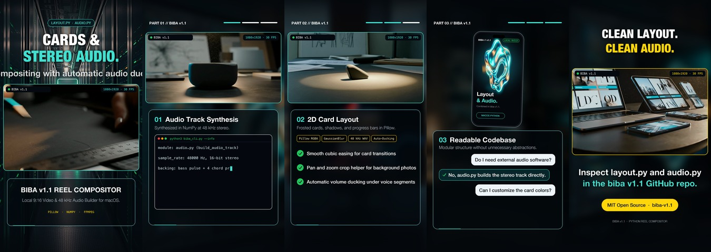

# biba

`biba` is a command-line timeline compositor for 9:16 vertical video (`1080x1920`, `30 fps`, H.264/AAC). It decodes local video clips over FFmpeg pipes, renders 2D text and card overlays with Pillow into a pre-allocated frame buffer, and mixes external audio or offline speech narration at `48 kHz` stereo.

## Preview

| Section 1-2 | Section 3-5 |
| :---: | :---: |
|  |  |

## Package Layout

```text
src/biba/
  __init__.py
  spec.py        # ReelTimeline dataclass and JSON loader/serializer
  decoder.py     # FFmpeg rawvideo stream reader and external audio decoder
  layout.py      # 2D card geometry, font loading, easing, color field fallback
  audio.py       # 48 kHz stereo mixer, STFT formant smoothing, piper/OS TTS
  compositor.py  # 5-section vertical frame compositor and H.264 pipe writer
  cli.py         # CLI entry point (init, render, probe)
examples/
  product_reel.json
tests/
  test_biba.py
```

## Installation

```bash
pip install -e .
```

Dependencies: `numpy`, `Pillow`, `imageio-ffmpeg`.

## Usage

Generate a starter JSON timeline:

```bash
biba init my_reel.json
```

Render a timeline JSON file to MP4:

```bash
biba render my_reel.json -o output/my_reel.mp4
```

Override video clips, background images, or audio tracks directly from the command line:

```bash
biba render examples/product_reel.json \
  --video path/to/clip.mp4 \
  --audio path/to/music.wav \
  --title "RELEASE 1.1" \
  -o output/custom.mp4
```

Check FFmpeg binary resolution and frame timing:

```bash
biba probe
```

## Running Tests

```bash
pytest
# or
python3 -m unittest discover -s tests -v
```

## License

MIT
